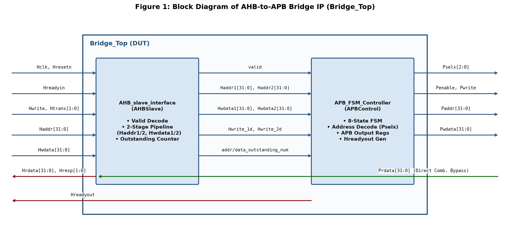
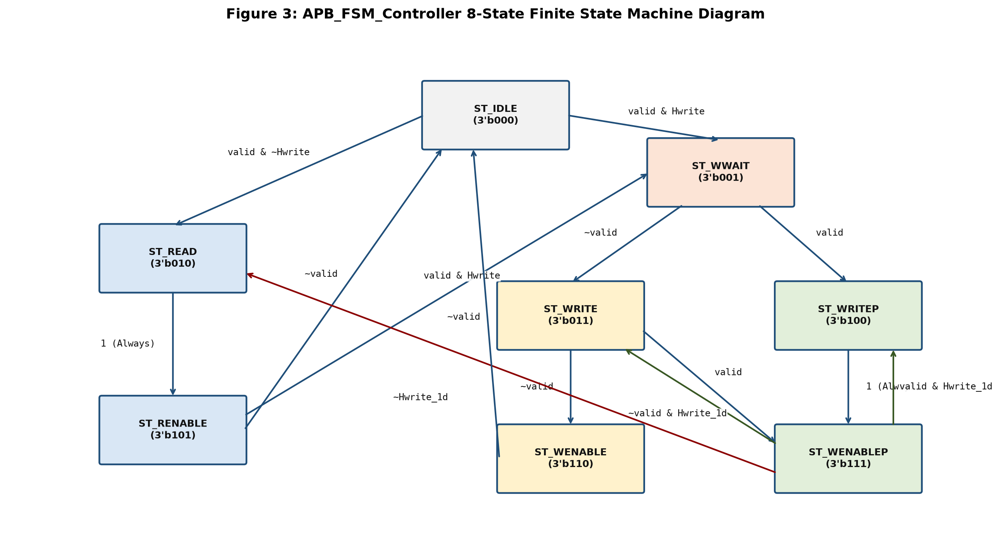
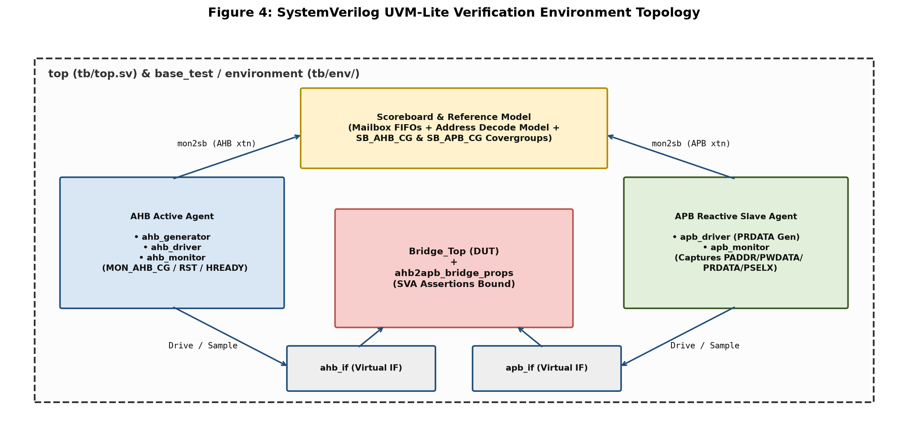
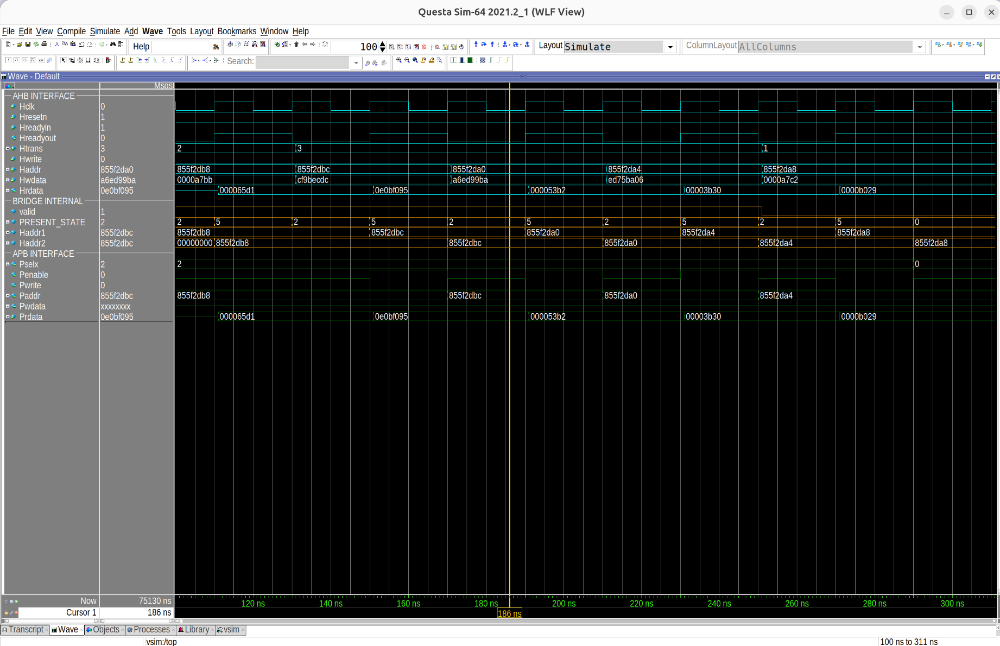
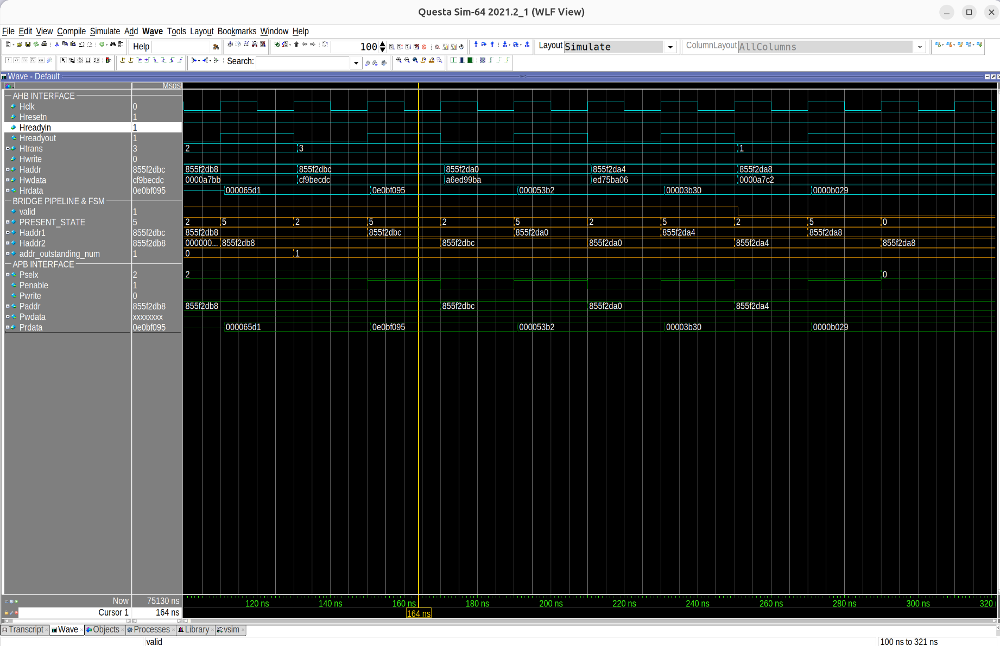
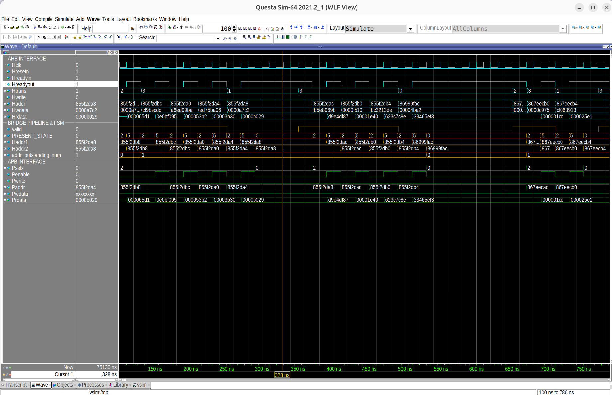

<div align="center">

# 🌉 AMBA AHB-to-APB Bridge — Design & Verification

[](tb/top.sv)
[](Makefile)
[](docs/ARM_IHI0033A_AMBA_AHB-Lite_SPEC.pdf)
[](REPORT.md#53-functional-coverage-sign-off)
[](REPORT.md#54-code-coverage-sign-off-and-waiver-matrix)
[](REPORT.md#51-regression-test-suite-summary)

<p align="center">
  <b>A complete Functional Verification project for an AMBA AHB-to-APB Bridge IP using a modular SystemVerilog (UVM-lite) testbench, SystemVerilog Assertions (SVA), and a self-checking Scoreboard, achieving 100.00% Functional and Adjusted Code Coverage sign-off.</b>
</p>

[📄 **Read Full Technical Report (`REPORT.md`)**](REPORT.md) · [📊 **Verification Plan (`VerificationSpecification_Final.xlsx`)**](docs/VerificationSpecification_Final.xlsx) · [👨‍💻 **Author**](#author)

</div>

---

## 📑 Table of Contents

* [1. Project Overview](#1-project-overview)
* [2. Key Highlights](#2-key-highlights)
* [3. Hardware Architecture (DUT)](#3-hardware-architecture-dut)
* [4. Verification Environment (UVM-Lite)](#4-verification-environment-uvm-lite)
* [5. Repository Directory Structure](#5-repository-directory-structure)
* [6. Verification Plan & Regression Results](#6-verification-plan--regression-results)
* [7. Simulation Waveform Evidence](#7-simulation-waveform-evidence)
* [8. Coverage Sign-Off Summary (100.00%)](#8-coverage-sign-off-summary-10000)
* [9. How to Run Simulation & Coverage](#9-how-to-run-simulation--coverage)
* [10. Documentation & References](#10-documentation--references)
* [11. Author](#author)

---

<a id="1-project-overview"></a>
## 1. 🎯 Project Overview

In modern System-on-Chip (SoC) designs, high-speed processors and DMA controllers communicate over the **Advanced High-performance Bus (AHB)**, while low-power peripherals (timers, UART, GPIO, I2C) reside on the **Advanced Peripheral Bus (APB)**.

The **AMBA AHB-to-APB Bridge** translates high-speed, pipelined AHB transfers into two-phase, non-pipelined APB transfers (`SETUP` and `ACCESS`). It buffers addresses and write data across clock cycles, generates wait states (`Hreadyout = 0`) when the APB bus is busy, and decodes memory addresses to select the target peripheral slave (`Pselx[2:0]`).

This repository presents both the **RTL design analysis** and a **self-checking SystemVerilog verification environment** built from scratch to verify protocol compliance, burst buffering, error filtering, and corner-case timing hazards.

---

<a id="2-key-highlights"></a>
## 2. ✨ Key Highlights

* **Modular UVM-Lite Testbench Architecture:** Built a clean, object-oriented SystemVerilog verification environment ([`tb/`](tb/)) featuring active AHB and reactive APB agents, virtual interfaces, parameterized mailboxes, and a golden reference scoreboard.
* **Comprehensive Burst & Protocol Verification:** Verified all $8$ AHB burst modes (`SINGLE`, `INCR`, `WRAP4`, `INCR4`, `WRAP8`, `INCR8`, `WRAP16`, `INCR16`), back-to-back write streams, `BUSY` wait-state insertion, reset recovery, and out-of-range address filtering (`1,338/1,338` transactions passed in [`mixed_seq_test.sv`](tb/tests/mixed_seq_test.sv)).
* **Assertion-Based Verification (ABV):** Bound a dedicated SystemVerilog Assertions module ([`ahb2apb_bridge_props.sv`](tb/assertions/ahb2apb_bridge_props.sv)) directly to the DUT to monitor burst address alignment and protocol handshakes on every clock cycle.
* **Real RTL Bug Discovery:** Successfully isolated and documented a micro-architectural pipeline hazard in [`APB_Controller_.v`](rtl/APB_Controller_.v) during zero-idle alternating `Write -> Read -> Write` transfers using [`back_to_back_transfer_seq_test.sv`](tb/tests/back_to_back_transfer_seq_test.sv).
* **100.00% Verification Closure:** Achieved **100.00% Functional Coverage** across all $5$ covergroups and **100.00% Adjusted Code Coverage** (Statements, Branches, Conditions, Expressions, FSM States, FSM Transitions, and Toggles) using formal engineering waivers in [`sim/exclude.do`](sim/exclude.do).

---

<a id="3-hardware-architecture-dut"></a>
## 3. 🏗️ Hardware Architecture (DUT)



The hardware Design Under Test (DUT) is located in the [`rtl/`](rtl/) directory and consists of three Verilog modules:

1. **[`Bridge_Top.v`](rtl/Bridge_Top.v) (Top-Level Wrapper):** Connects the AHB slave interface and the APB FSM controller, routing internal pipeline buses (`Haddr1/2`, `Hwdata1/2`, `Hwrite_1d/2d`, `valid`, and outstanding counters).
2. **[`AHB_Slave_Interface_.v`](rtl/AHB_Slave_Interface_.v) (AHB Front-End & Pipeline):**
   * Validates incoming AHB requests (`valid = 1`) when `Hresetn == 1`, `Hreadyin == 1`, `Htrans` is `NONSEQ` (`2'b10`) or `SEQ` (`2'b11`), and `Haddr` falls within `0x8000_0000` to `0x8BFF_FFFF`.
   * Implements a 2-stage pipeline (`Haddr1 -> Haddr2`, `Hwdata1 -> Hwdata2`, `Hwrite_1d -> Hwrite_2d`) to prevent data loss when bridging pipelined AHB transfers to two-cycle APB transfers.
   * Tracks in-flight beats via `addr_outstanding_num` and `data_outstanding_num`.
3. **[`APB_Controller_.v`](rtl/APB_Controller_.v) (8-State FSM & APB Master):**
   * Implements an 8-state finite state machine (`ST_IDLE`, `ST_WWAIT`, `ST_READ`, `ST_WRITE`, `ST_WRITEP`, `ST_RENABLE`, `ST_WENABLE`, `ST_WENABLEP`) that sequences APB `SETUP` and `ACCESS` phases and controls `Hreadyout`.



### Memory Map & APB Slave Decoding

| Address Range | Size | Target Peripheral | `Pselx[2:0]` | Bridge Action |
| :--- | :---: | :--- | :---: | :--- |
| `0x8000_0000` – `0x83FF_FFFF` | $64\text{ MB}$ | APB Slave 0 | `3'b001` | Valid Read / Write access (`valid = 1`) |
| `0x8400_0000` – `0x87FF_FFFF` | $64\text{ MB}$ | APB Slave 1 | `3'b010` | Valid Read / Write access (`valid = 1`) |
| `0x8800_0000` – `0x8BFF_FFFF` | $64\text{ MB}$ | APB Slave 2 | `3'b100` | Valid Read / Write access (`valid = 1`) |
| Outside `0x8000_0000` – `0x8BFF_FFFF` | — | Unmapped / Error Space | `3'b000` | Filtered out (`valid = 0`, APB bus idle) |

> 📖 For detailed logic diagrams and cycle-by-cycle timing explanations, see **[Section 2 & Section 3 of `REPORT.md`](REPORT.md#2-address-map-and-protocol-specification)**.

---

<a id="4-verification-environment-uvm-lite"></a>
## 4. 🧪 Verification Environment (UVM-Lite)



The verification environment in [`tb/`](tb/) follows a layered, object-oriented architecture:

* **Top-Level Testbench ([`tb/top.sv`](tb/top.sv)):** Generates the $100\text{ MHz}$ clock, instantiates physical interfaces ([`ahb_if.sv`](tb/interfaces/ahb_if.sv) and [`apb_if.sv`](tb/interfaces/apb_if.sv)), binds the SVA checker ([`ahb2apb_bridge_props.sv`](tb/assertions/ahb2apb_bridge_props.sv)), and launches the test selected via `+TEST=...`.
* **AHB Active Agent ([`tb/agents/ahb_agent/`](tb/agents/ahb_agent/)):**
  * [`ahb_trans_item.sv`](tb/agents/ahb_agent/ahb_trans_item.sv): Transaction class with constraints for burst modes, address alignment, and error injection.
  * [`ahb_generator.sv`](tb/agents/ahb_agent/ahb_generator.sv): Generates single transfers, $8$ burst types (`INCR`, `WRAP4/8/16`, `INCR4/8/16`), and back-to-back sequences.
  * [`ahb_driver.sv`](tb/agents/ahb_agent/ahb_driver.sv): Drives pipelined address and data phases onto the AHB bus synchronized with `Hreadyout`.
  * [`ahb_monitor.sv`](tb/agents/ahb_agent/ahb_monitor.sv): Observes valid AHB transfers, samples protocol covergroups (`MON_AHB_CG`, `MON_AHB_RST_CG`, `MON_AHB_HREADY_CG`), and sends transactions to the scoreboard.
* **APB Reactive Agent ([`tb/agents/apb_agent/`](tb/agents/apb_agent/)):**
  * [`apb_driver.sv`](tb/agents/apb_agent/apb_driver.sv) & [`apb_monitor.sv`](tb/agents/apb_agent/apb_monitor.sv): Responds to APB read requests with random `Prdata` and captures completed APB `ACCESS` transfers (`Penable && Pselx != 0`).
* **Scoreboard & Reference Model ([`tb/env/scoreboard.sv`](tb/env/scoreboard.sv)):**
  * Predicts the expected APB address, write/read payload, and slave select strobe (`exp_Pselx`), comparing them against actual APB monitor packets on every beat.

---

<a id="5-repository-directory-structure"></a>
## 5. 📂 Repository Directory Structure

Click on any file link below to inspect its source code or documentation directly:

```text
├── Makefile                                         # Master build, simulation & coverage automation script
├── REPORT.md                                        # Full Design & Verification Technical Report
├── gen_report_images.py                             # Python script to generate block & timing diagrams
│
├── docs/                                            # Specifications, Verification Plan & Figures
│   ├── VerificationSpecification_Final.xlsx         # Detailed Verification Plan, Test Matrix & Coverage Map
│   ├── ARM_IHI0033A_AMBA_AHB-Lite_SPEC.pdf          # Official ARM AMBA 3 AHB-Lite Protocol Specification
│   ├── Lecture10.pdf                                # AHB-to-APB Bridge Micro-architecture Reference Lecture
│   └── images/                                      # Block diagrams, FSM diagrams & QuestaSim waveforms
│
├── rtl/                                             # Synthesizable Verilog RTL Design (DUT)
│   ├── Bridge_Top.v                                 # Top-level AHB2APB Bridge wrapper
│   ├── AHB_Slave_Interface_.v                       # AHB slave decode, pipeline stages & counters
│   └── APB_Controller_.v                            # 8-state APB FSM controller & address decoder
│
├── tb/                                              # SystemVerilog UVM-Lite Verification Environment
│   ├── top.sv                                       # Top testbench module & SVA bind
│   ├── interfaces/
│   │   ├── ahb_if.sv                                # AHB bus interface & clocking blocks
│   │   └── apb_if.sv                                # APB bus interface & clocking blocks
│   ├── assertions/
│   │   └── ahb2apb_bridge_props.sv                  # SystemVerilog Assertions (SVA) module
│   ├── agents/
│   │   ├── ahb_agent/                               # AHB Active Agent
│   │   │   ├── ahb_agent.sv
│   │   │   ├── ahb_trans_item.sv
│   │   │   ├── ahb_generator.sv
│   │   │   ├── ahb_driver.sv
│   │   │   └── ahb_monitor.sv
│   │   └── apb_agent/                               # APB Reactive Slave Agent
│   │       ├── apb_agent.sv
│   │       ├── apb_trans_item.sv
│   │       ├── apb_driver.sv
│   │       └── apb_monitor.sv
│   ├── env/
│   │   ├── environment.sv                           # Verification environment container
│   │   └── scoreboard.sv                            # Self-checking reference model & covergroups
│   └── tests/                                       # Regression Test Suite
│       ├── base_test.sv                             # Base test class
│       ├── normal_burst_seq_test.sv                 # TC_01: All 8 AHB burst modes (Read & Write)
│       ├── back_to_back_write_seq_test.sv           # TC_02: Continuous pipelined write streaming
│       ├── error_injection_seq_test.sv              # TC_03: Out-of-range address error filtering
│       ├── burst_seq_w_busy_in_read_trans.sv        # TC_04: BUSY wait-state insertion in burst reads
│       ├── burst_seq_w_reset_test.sv                # TC_05: Multi-burst sequences with reset recovery
│       ├── burst_seq_w_busy_in_read_write_trans.sv  # TC_06: Burst Read/Write with wait-state control
│       ├── mixed_seq_test.sv                        # TC_07: Full 1,338-transaction stress regression
│       └── back_to_back_transfer_seq_test.sv        # TC_08: Diagnostic test isolating RTL B2B hazard
│
└── sim/                                             # Simulation & Coverage Scripts
    └── exclude.do                                   # Formal QuestaSim coverage exclusion script
```

---

<a id="6-verification-plan--regression-results"></a>
## 6. 📋 Verification Plan & Regression Results

The complete verification plan, feature extraction, and testbench mapping are documented in **[`docs/VerificationSpecification_Final.xlsx`](docs/VerificationSpecification_Final.xlsx)**. All $7$ functional test suites pass with **zero failures**:

| Test ID | Test File (Clickable) | Verified Beats | Result | Verification Objective |
| :---: | :--- | :---: | :---: | :--- |
| **TC_01** | [`normal_burst_seq_test.sv`](tb/tests/normal_burst_seq_test.sv) | $261$ | ✅ **PASS (261/0)** | Verifies all $8$ AHB burst modes (`SINGLE` to `INCR16`/`WRAP16`) across all $3$ APB slaves. |
| **TC_02** | [`back_to_back_write_seq_test.sv`](tb/tests/back_to_back_write_seq_test.sv) | $35$ | ✅ **PASS (35/0)** | Verifies continuous back-to-back write bursts and `ST_WENABLEP -> ST_WRITE` pipeline drain. |
| **TC_03** | [`error_injection_seq_test.sv`](tb/tests/error_injection_seq_test.sv) | $154$ | ✅ **PASS (154/0)** | Injects illegal addresses (`>= 0x8C00_0000`) to verify `valid = 0` and `Pselx = 3'b000` filtering. |
| **TC_04** | [`burst_seq_w_busy_in_read_trans.sv`](tb/tests/burst_seq_w_busy_in_read_trans.sv) | $150$ | ✅ **PASS (150/0)** | Inserts `Htrans = BUSY` (`2'b01`) cycles during read bursts to verify pipeline hold behavior. |
| **TC_05** | [`burst_seq_w_reset_test.sv`](tb/tests/burst_seq_w_reset_test.sv) | $768$ | ✅ **PASS (768/0)** | Verifies multi-burst operation and state recovery across reset sequences. |
| **TC_06** | [`burst_seq_w_busy_in_read_write_trans.sv`](tb/tests/burst_seq_w_busy_in_read_write_trans.sv) | $261$ | ✅ **PASS (261/0)** | Verifies combined read and write bursts with wait-state control. |
| **TC_07** | [`mixed_seq_test.sv`](tb/tests/mixed_seq_test.sv) | $1,338$ | ✅ **PASS (1338/0)** | High-stress regression combining all burst types, directions, and slave targets. |
| **TC_08** | [`back_to_back_transfer_seq_test.sv`](tb/tests/back_to_back_transfer_seq_test.sv) | $15$ | 🔍 **Bug Isolated** | Diagnostic test exposing RTL address hazard on zero-idle `Write -> Read -> Write` transitions. |

> 🐛 **RTL Bug Discovery Highlight:** In [`APB_Controller_.v`](rtl/APB_Controller_.v) (lines 258–265, `WENABLEP_TO_WRITE_OR_READ`), when a pipelined write is immediately followed by a single read without an idle cycle, the RTL latches `Paddr_temp = Haddr2` (2-cycle delayed address) instead of `Haddr1`. Full root-cause analysis is available in **[Section 5.2 of `REPORT.md`](REPORT.md#52-rtl-bug-discovery-and-root-cause-analysis)**.

---

<a id="7-simulation-waveform-evidence"></a>
## 7. 📈 Simulation Waveform Evidence

### Normal Burst Transfer (`TC_01`)


### Pipelined Back-to-Back Write (`TC_02`)


### Out-of-Range Error Filtering (`TC_03`)


---

<a id="8-coverage-sign-off-summary-10000"></a>
## 8. 🏆 Coverage Sign-Off Summary (100.00%)

### 8.1. Functional Coverage Sign-Off (`100.00%`)

All $5$ SystemVerilog covergroups defined in [`scoreboard.sv`](tb/env/scoreboard.sv) and [`ahb_monitor.sv`](tb/agents/ahb_agent/ahb_monitor.sv) achieved **100.00% coverage**:

```text
# AHB2APB_BRIDGE_SCB_SUMMARY: total=1338, pass=1338, fail=0
# TEST PASSED
# SB_AHB_CG:         100.00% coverage achieved.
# SB_APB_CG:         100.00% coverage achieved.
# MON_AHB_CG:        100.00% coverage achieved.
# MON_AHB_RST_CG:    100.00% coverage achieved.
# MON_AHB_HREADY_CG: 100.00% coverage achieved.
```

### 8.2. QuestaSim Code Coverage Sign-Off (`100.00%`)

Using formal exclusions in **[`sim/exclude.do`](sim/exclude.do)** for physically tied pins (`Hreadyin = 1'b1`), word-aligned LSBs (`Haddr[1:0] = 2'b00`), fixed upper address decode bits (`0x8000_0000`–`0x8BFF_FFFF`), and unreferenced RTL registers, the DUT achieved **100.00% Code Coverage**:

| Coverage Metric | Active Bins | Hits | Misses | Raw DUT Coverage | Adjusted Sign-Off Coverage |
| :--- | :---: | :---: | :---: | :---: | :---: |
| **Statements** | $116$ | $116$ | $0$ | $97.36\%$ | **100.00%** |
| **Branches** | $62$ | $62$ | $0$ | $94.59\%$ | **100.00%** |
| **Conditions** | $13$ | $13$ | $0$ | $65.57\%$ | **100.00%** |
| **Expressions** | $1$ | $1$ | $0$ | $100.00\%$ | **100.00%** |
| **FSM States** | $8$ | $8$ | $0$ | $100.00\%$ | **100.00%** |
| **FSM Transitions** | $17$ | $17$ | $0$ | $86.36\%$ | **100.00%** |
| **Toggles** | $1,138$ | $1,138$ | $0$ | $96.33\%$ | **100.00%** |
| **Total Code Coverage** | **$1,355$** | **$1,355$** | **$0$** | **$91.70\%$** | **100.00%** |

---

<a id="9-how-to-run-simulation--coverage"></a>
## 9. 🚀 How to Run Simulation & Coverage

All build, simulation, waveform viewing, and coverage reporting tasks are automated via the **[`Makefile`](Makefile)**.

### Prerequisites
* **Simulator:** Siemens EDA QuestaSim (`vlib`, `vlog`, `vsim`, `vcover` in system `PATH`).
* **OS:** Linux (Ubuntu) or Windows with GNU Make.

### 1. Run a Single Functional Test
```bash
make all TEST=normal_burst_seq_test ASSERT_OFF=1
```

### 2. Open Waveform Viewer in QuestaSim GUI
```bash
make wave TEST=normal_burst_seq_test ASSERT_OFF=1
```

### 3. Run Full Coverage Closure & Generate HTML/Text Reports
```bash
make all_cov TEST=mixed_seq_test ASSERT_OFF=1
```
* **Text Summary Report:** `sim/coverage_report/summary.txt`
* **Detailed Line-by-Line Report:** `sim/coverage_report/details.txt`
* **Interactive HTML Report:** Open `sim/coverage_html/index.html` in any browser.

### 4. Run Full 7-Test Regression Suite
```bash
for test in normal_burst_seq_test back_to_back_write_seq_test error_injection_seq_test burst_seq_w_busy_in_read_trans burst_seq_w_reset_test burst_seq_w_busy_in_read_write_trans mixed_seq_test; do \
    echo "==================== RUNNING: $test ===================="; \
    make all TEST=$test ASSERT_OFF=1 > /dev/null 2>&1; \
    grep -E "TEST PASSED|TEST FAILED" sim/sim_${test}.log || grep -E "TEST PASSED|TEST FAILED" transcript; \
done
```

---

<a id="10-documentation--references"></a>
## 10. 📚 Documentation & References

All project specifications, verification plans, and reference manuals are stored in the repository and can be accessed via the links below:

1. 📄 **[Full Technical Design & Verification Report (`REPORT.md`)](REPORT.md)** — Complete micro-architecture specification, FSM state tables, timing diagrams, and coverage waiver analysis.
2. 📊 **[Verification Plan & Specification (`docs/VerificationSpecification_Final.xlsx`)](docs/VerificationSpecification_Final.xlsx)** — Detailed verification feature matrix, stimulus plan, checker mapping, and coverage targets.
3. 📘 **[ARM AMBA 3 AHB-Lite Protocol Specification (`docs/ARM_IHI0033A_AMBA_AHB-Lite_SPEC.pdf`)](docs/ARM_IHI0033A_AMBA_AHB-Lite_SPEC.pdf)** — Official ARM IHI 0033A standard used as the golden protocol reference for AHB-Lite transfer types, burst wrapping boundaries, and wait-state handshakes.
4. 📙 **[AHB-to-APB Bridge Architecture Reference (`docs/Lecture10.pdf`)](docs/Lecture10.pdf)** — Reference lecture material providing foundational concepts for bridge state machine design and APB peripheral interfacing.

---

<a id="author"></a>
<h2><strong>👨‍💻 Author</strong></h2>
<table>
  <tr>
    <td colspan="3" align="center">
      <br>
      <h2>⚡ Hoàng Ngọc Gia Bão</h2>
      <p><b>Integrated Circuit Design · FPT University</b></p>
      <br>
      <p><b>📬 Connect with me</b></p>
    </td>
  </tr>
  <tr>
    <td align="center" width="300">
      <br>
      <a href="mailto:baohoang037@gmail.com"></a>
      <p><a href="mailto:baohoang037@gmail.com">baohoang037@gmail.com</a></p>
    </td>
    <td align="center" width="300">
      <br>
      <a href="https://www.linkedin.com/in/hoang-ngoc-gia-bao-883124235/"></a>
      <p><a href="https://www.linkedin.com/in/hoang-ngoc-gia-bao-883124235/">View professional profile ↗</a></p>
    </td>
    <td align="center" width="300">
      <br>
      <a href="https://github.com/baohoang037"></a>
      <p><a href="https://github.com/baohoang037">@baohoang037 ↗</a></p>
    </td>
  </tr>
</table>