# AMBA AHB-TO-APB BRIDGE DESIGN AND FUNCTIONAL VERIFICATION SPECIFICATION

**Author:** Hoàng Ngọc Gia Bão  
**Project:** AMBA AHB-to-APB Bridge IP Design & Verification  
**Simulator & Tools:** Siemens EDA QuestaSim 2021.2_1, SystemVerilog, SVA  
**Sign-Off Status:** 100.00% Functional Coverage | 100.00% Adjusted Code Coverage  

---

## Contents

* [LIST OF TABLES](#list-of-tables)
* [LIST OF FIGURES](#list-of-figures)
* [1. Overview](#1-overview)
  * [1.1. Introduction](#11-introduction)
  * [1.2. Main Features](#12-main-features)
  * [1.3. Block Diagram](#13-block-diagram)
    * [1.3.1. AHB Slave Interface](#131-ahb-slave-interface)
    * [1.3.2. APB FSM Controller](#132-apb-fsm-controller)
    * [1.3.3. SystemVerilog Assertions Module](#133-systemverilog-assertions-module)
  * [1.4. Interface Signals](#14-interface-signals)
* [2. Address Map and Protocol Specification](#2-address-map-and-protocol-specification)
  * [2.1. APB Address Decode Summary](#21-apb-address-decode-summary)
  * [2.2. AHB Transfer Type Encoding](#22-ahb-transfer-type-encoding)
  * [2.3. AHB Burst Operation Modes](#23-ahb-burst-operation-modes)
  * [2.4. Internal Pipeline Registers](#24-internal-pipeline-registers)
* [3. Functional Description](#3-functional-description)
  * [3.1. AHB Slave Interface Logic](#31-ahb-slave-interface-logic)
    * [3.1.1. Valid Signal Generation](#311-valid-signal-generation)
    * [3.1.2. Two-Stage Address and Data Pipelining](#312-two-stage-address-and-data-pipelining)
    * [3.1.3. Outstanding Transaction Tracking](#313-outstanding-transaction-tracking)
  * [3.2. APB FSM Controller Logic](#32-apb-fsm-controller-logic)
    * [3.2.1. Finite State Machine States](#321-finite-state-machine-states)
    * [3.2.2. State Transition Logic](#322-state-transition-logic)
    * [3.2.3. Combinational and Registered Output Logic](#323-combinational-and-registered-output-logic)
  * [3.3. Protocol Timing and Waveform Analysis](#33-protocol-timing-and-waveform-analysis)
    * [3.3.1. Single Read Transfer Timing](#331-single-read-transfer-timing)
    * [3.3.2. Single Write Transfer Timing](#332-single-write-transfer-timing)
    * [3.3.3. Pipelined Burst Write Timing](#333-pipelined-burst-write-timing)
    * [3.3.4. Burst Read with BUSY Wait States and Error Filtering](#334-burst-read-with-busy-wait-states-and-error-filtering)
* [4. Verification Environment Architecture](#4-verification-environment-architecture)
  * [4.1. Testbench Topology](#41-testbench-topology)
  * [4.2. AHB and APB Verification Agents](#42-ahb-and-apb-verification-agents)
  * [4.3. Scoreboard and Reference Model](#43-scoreboard-and-reference-model)
  * [4.4. SystemVerilog Assertions and Functional Coverage](#44-systemverilog-assertions-and-functional-coverage)
* [5. Verification Results and Coverage Sign-Off](#5-verification-results-and-coverage-sign-off)
  * [5.1. Regression Test Suite Summary](#51-regression-test-suite-summary)
    * [5.1.1. Simulation Waveform Verification Evidence](#511-simulation-waveform-verification-evidence)
  * [5.2. RTL Bug Discovery and Root Cause Analysis](#52-rtl-bug-discovery-and-root-cause-analysis)
  * [5.3. Functional Coverage Sign-Off](#53-functional-coverage-sign-off)
  * [5.4. Code Coverage Sign-Off and Waiver Matrix](#54-code-coverage-sign-off-and-waiver-matrix)
* [6. History](#6-history)

---

## LIST OF TABLES

* [Table 1: Interface Signals of AHB-to-APB Bridge IP](#table-1)
* [Table 2: APB Peripheral Address Map and Slave Select Encoding](#table-2)
* [Table 3: AHB Transfer Type Encoding (Htrans)](#table-3)
* [Table 4: Supported AHB Burst Operation Modes (Hburst)](#table-4)
* [Table 5: Internal Pipeline and Tracking Registers](#table-5)
* [Table 6: APB 8-State FSM Encoding and Functional Description](#table-6)
* [Table 7: APB FSM Next-State and Output Control Truth Table](#table-7)
* [Table 8: Functional Regression Test Suite Summary](#table-8)
* [Table 9: Functional Coverage Sign-Off Summary (Covergroups)](#table-9)
* [Table 10: QuestaSim Code Coverage Sign-Off Summary](#table-10)
* [Table 11: Code Coverage Exclusion and Engineering Waiver Matrix](#table-11)
* [Table 12: Document Revision History](#table-12)

---

## LIST OF FIGURES

* [Figure 1: Block Diagram of AHB-to-APB Bridge IP (Bridge_Top)](#figure-1)
* [Figure 2: Logic Diagram of AHB_slave_interface (Pipeline and Valid Decode)](#figure-2)
* [Figure 3: APB_FSM_Controller 8-State Finite State Machine Diagram](#figure-3)
* [Figure 4: SystemVerilog UVM-Lite Verification Environment Topology](#figure-4)
* [Figure 5: Single Read Transfer Timing Waveform (Specification)](#figure-5)
* [Figure 6: Single Write Transfer Timing Waveform (Specification)](#figure-6)
* [Figure 7: Pipelined Burst Write Timing Waveform (Specification)](#figure-7)
* [Figure 8: BUSY Transfer Filtering and Out-of-Range Address Waveform (Specification)](#figure-8)
* [Figure 9: QuestaSim Simulation Waveform for TC_01 (normal_burst_seq_test)](#figure-9)
* [Figure 10: QuestaSim Simulation Waveform for TC_02 (back_to_back_write_seq_test)](#figure-10)
* [Figure 11: QuestaSim Simulation Waveform for TC_03 (error_injection_seq_test)](#figure-11)

---

## 1. Overview

### 1.1. Introduction

In modern System-on-Chip (SoC) architectures based on the ARM AMBA specification, high-speed processors, DMA controllers, and memory subsystems communicate over the **Advanced High-performance Bus (AHB)**, whereas low-bandwidth peripheral devices (such as UARTs, Timers, GPIOs, and I2C controllers) reside on the low-power **Advanced Peripheral Bus (APB)**.

The **AMBA AHB-to-APB Bridge** serves as the critical protocol translator between these two bus domains. It acts as an AHB slave on the system backbone and as the sole APB master driving the peripheral subsystem. The bridge buffers address, control, and write data from pipelined AHB transfers, inserts wait states (`Hreadyout = 0`) when the non-pipelined two-cycle APB protocol (`SETUP` and `ACCESS`) requires backpressure, and decodes peripheral addresses to generate one-hot slave select strobes (`Pselx[2:0]`).

### 1.2. Main Features

**AHB Slave Interface Features:**
* Compliant with AMBA 2.0 AHB-Lite slave interface protocol (32-bit address and 32-bit data buses).
* Supports `IDLE`, `BUSY`, `NONSEQ`, and `SEQ` transfer types (`Htrans[1:0]`).
* Supports all 8 AHB burst configurations (`SINGLE`, `INCR`, `WRAP4`, `INCR4`, `WRAP8`, `INCR8`, `WRAP16`, `INCR16`).
* Two-stage hardware pipeline registers (`Haddr1`, `Haddr2`, `Hwdata1`, `Hwdata2`, `Hwrite_1d`, `Hwrite_2d`) to absorb pipelined AHB burst beats without data loss during APB wait cycles.
* Hardware address range validator (covering `0x8000_0000` to `0x8BFF_FFFF`) that automatically filters out-of-range accesses and `BUSY` cycles.
* Zero-latency combinational read data bypass (`Hrdata = Prdata`).

**APB Master Controller Features:**
* Compliant with AMBA APB two-phase transfer protocol (`SETUP` phase followed by `ACCESS` phase via `Penable`).
* 8-state Moore/Mealy hybrid Finite State Machine (`ST_IDLE`, `ST_WWAIT`, `ST_READ`, `ST_WRITE`, `ST_WRITEP`, `ST_RENABLE`, `ST_WENABLE`, `ST_WENABLEP`).
* Built-in combinational address decoder supporting 3 independent APB slave regions (`Pselx[2:0] = 3'b001`, `3'b010`, `3'b100`).
* Automatic AHB wait-state generation (`Hreadyout`) to synchronize high-speed AHB bursts with two-cycle APB peripheral accesses.

### 1.3. Block Diagram

<a id="figure-1"></a>
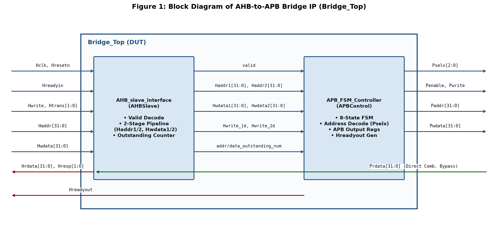

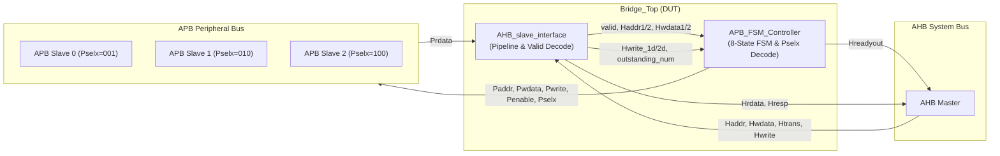
*Figure 1: Block Diagram of AHB-to-APB Bridge IP (Bridge_Top)*

#### 1.3.1. AHB Slave Interface

* **Description:** Connects directly to the system AHB matrix (`Hclk`, `Hresetn`, `Hwrite`, `Hreadyin`, `Htrans`, `Haddr`, `Hwdata`) and samples incoming transfers qualified by `Hreadyin` and `Hreadyout`.
* **Purpose:** Validates whether an incoming AHB transfer targets a legal APB peripheral address (`valid = 1`), tracks the number of pending address and data phases (`addr_outstanding_num`, `data_outstanding_num`), and shifts AHB addresses, write data, and direction control through two sequential pipeline stages (`Haddr1 -> Haddr2`, `Hwdata1 -> Hwdata2`, `Hwrite_1d -> Hwrite_2d`). It also routes `Prdata` directly to `Hrdata`.

#### 1.3.2. APB FSM Controller

* **Description:** The core protocol conversion engine of the IP. It receives `valid`, buffered pipeline signals, and outstanding transaction counters from `AHB_slave_interface`.
* **Purpose:** Sequences APB `SETUP` (`Pselx != 0`, `Penable = 0`) and `ACCESS` (`Pselx != 0`, `Penable = 1`) phases across 8 FSM states while asserting/deasserting `Hreadyout` to pace the AHB master.

#### 1.3.3. SystemVerilog Assertions Module

* **Description:** Non-intrusive property checker (`ahb2apb_bridge_props`) bound to `Bridge_Top`.
* **Purpose:** Continuously monitors AHB burst address alignment, `HTRANS` state transitions, and APB `SETUP`-to-`ACCESS` protocol handshakes on every rising clock edge.

### 1.4. Interface Signals

<a id="table-1"></a>

| Signal Name | Width | Direction | Bus Domain | Description |
| :--- | :---: | :---: | :---: | :--- |
| `Hclk` | 1 | Input | Global | System clock signal (rising-edge triggered). |
| `Hresetn` | 1 | Input | Global | Active-low reset signal. Initializes FSM to `ST_IDLE` and clears pipeline registers. |
| `Hreadyin` | 1 | Input | AHB | Indicates previous AHB transfer is complete (tied to `1'b1` in single-master topology). |
| `Hwrite` | 1 | Input | AHB | Transfer direction (`1` = Write, `0` = Read). |
| `Htrans[1:0]` | 2 | Input | AHB | Transfer type (`00` = IDLE, `01` = BUSY, `10` = NONSEQ, `11` = SEQ). |
| `Haddr[31:0]` | 32 | Input | AHB | 32-bit AHB system address bus. |
| `Hwdata[31:0]` | 32 | Input | AHB | 32-bit AHB write data bus driven during the data phase. |
| `Prdata[31:0]` | 32 | Input | APB | 32-bit read data bus returned from the selected APB slave. |
| `Hreadyout` | 1 | Output | AHB | AHB ready output (`1` = transfer ready/complete, `0` = insert wait state). |
| `Hresp[1:0]` | 2 | Output | AHB | AHB transfer response (`2'b00` = OKAY). |
| `Hrdata[31:0]` | 32 | Output | AHB | 32-bit AHB read data bus (combinationally driven by `Prdata`). |
| `Pselx[2:0]` | 3 | Output | APB | One-hot APB slave select (`001` = Slave 1, `010` = Slave 2, `100` = Slave 3). |
| `Penable` | 1 | Output | APB | APB enable strobe asserted during the second cycle (`ACCESS` phase) of an APB transfer. |
| `Pwrite` | 1 | Output | APB | APB transfer direction (`1` = Write, `0` = Read). |
| `Paddr[31:0]` | 32 | Output | APB | 32-bit registered APB address bus. |
| `Pwdata[31:0]` | 32 | Output | APB | 32-bit registered APB write data bus. |

*Table 1: Interface Signals of AHB-to-APB Bridge IP*

---

## 2. Address Map and Protocol Specification

### 2.1. APB Address Decode Summary

The bridge decodes a 192 MB peripheral aperture from `0x8000_0000` to `0x8BFF_FFFF`, divided equally among three 64 MB APB slave regions. Any access outside this aperture deasserts `valid` and drives `Pselx = 3'b000`.

<a id="table-2"></a>

| Address Range | Size | Target Peripheral | `tempselx[2:0]` / `Pselx[2:0]` | Access Behaviour |
| :--- | :---: | :--- | :---: | :--- |
| `0x0000_0000` to `0x7FFF_FFFF` | 2048 MB | Unmapped / Reserved | `3'b000` | Ignored (`valid = 0`, no APB transaction). |
| `0x8000_0000` to `0x83FF_FFFF` | 64 MB | APB Peripheral Slave 0 | `3'b001` | Valid R/W access via `Pselx[0] = 1`. |
| `0x8400_0000` to `0x87FF_FFFF` | 64 MB | APB Peripheral Slave 1 | `3'b010` | Valid R/W access via `Pselx[1] = 1`. |
| `0x8800_0000` to `0x8BFF_FFFF` | 64 MB | APB Peripheral Slave 2 | `3'b100` | Valid R/W access via `Pselx[2] = 1`. |
| `0x8C00_0000` to `0xFFFF_FFFF` | 1856 MB | Unmapped / Error Space | `3'b000` | Blocked (`valid = 0`, no APB transaction). |

*Table 2: APB Peripheral Address Map and Slave Select Encoding*

### 2.2. AHB Transfer Type Encoding

<a id="table-3"></a>

| `Htrans[1:0]` | Mnemonic | Description | Bridge Action |
| :---: | :---: | :--- | :--- |
| `2'b00` | `IDLE` | Master does not require a data transfer. | `valid = 0`; decrements `addr_outstanding_num` if pending. |
| `2'b01` | `BUSY` | Master is stalling in the middle of a burst. | `valid = 0`; holds current pipeline state without advancing counter. |
| `2'b10` | `NONSEQ` | Single transfer or first beat of a burst. | `valid = 1` (if within legal address range); initiates FSM. |
| `2'b11` | `SEQ` | Remaining beats of a burst transfer. | `valid = 1` (if within legal address range); streams through FSM. |

*Table 3: AHB Transfer Type Encoding (Htrans)*

### 2.3. AHB Burst Operation Modes

<a id="table-4"></a>

| `Hburst[2:0]` | Mnemonic | Beats | Address Progression (32-bit Word Aligned, `Hsize = 3'b010`) |
| :---: | :---: | :---: | :--- |
| `3'b000` | `SINGLE` | 1 | Single independent transfer (`NONSEQ`). |
| `3'b001` | `INCR` | Unspecified | Incrementing burst (`+4` bytes per beat) of arbitrary length. |
| `3'b010` | `WRAP4` | 4 | 4-beat wrapping burst (wraps at 16-byte address boundary, `Haddr[3:2]`). |
| `3'b011` | `INCR4` | 4 | 4-beat incrementing burst (`+4` bytes per beat). |
| `3'b100` | `WRAP8` | 8 | 8-beat wrapping burst (wraps at 32-byte address boundary, `Haddr[4:2]`). |
| `3'b101` | `INCR8` | 8 | 8-beat incrementing burst (`+4` bytes per beat). |
| `3'b110` | `WRAP16` | 16 | 16-beat wrapping burst (wraps at 64-byte address boundary, `Haddr[5:2]`). |
| `3'b111` | `INCR16` | 16 | 16-beat incrementing burst (`+4` bytes per beat). |

*Table 4: Supported AHB Burst Operation Modes (Hburst)*

### 2.4. Internal Pipeline Registers

<a id="table-5"></a>

| Register / Signal | Width | Reset Value | Source Module | Functional Description |
| :--- | :---: | :---: | :---: | :--- |
| `Haddr1` | 32 | `32'h0000_0000` | `AHB_slave_interface` | Stage-1 pipeline buffer capturing `Haddr` on `posedge Hclk`. |
| `Haddr2` | 32 | `32'h0000_0000` | `AHB_slave_interface` | Stage-2 pipeline buffer capturing `Haddr1` on `posedge Hclk` for `ST_WENABLEP`. |
| `Hwdata1` | 32 | `32'h0000_0000` | `AHB_slave_interface` | Stage-1 write data pipeline register (`Hwdata1 <= Hwdata`). |
| `Hwdata2` | 32 | `32'h0000_0000` | `AHB_slave_interface` | Stage-2 write data pipeline register (`Hwdata2 <= Hwdata1`). |
| `Hwrite_1d` | 1 | `1'b0` | `AHB_slave_interface` | 1-cycle delayed write control bit (`Hwrite_1d <= Hwrite`). |
| `Hwrite_2d` | 1 | `1'b0` | `AHB_slave_interface` | 2-cycle delayed write control bit (`Hwrite_2d <= Hwrite_1d`). |
| `addr_outstanding_num` | 2 | `2'b00` | `AHB_slave_interface` | Tracks uncompleted AHB address phases (`+1` on valid beat, `-1` on `IDLE`). |
| `data_outstanding_num` | 1 | `1'b0` | `AHB_slave_interface` | Asserts to `1'b1` when `addr_outstanding_num > 0` and transfer is not `BUSY`. |

*Table 5: Internal Pipeline and Tracking Registers*

---

## 3. Functional Description

### 3.1. AHB Slave Interface Logic

<a id="figure-2"></a>
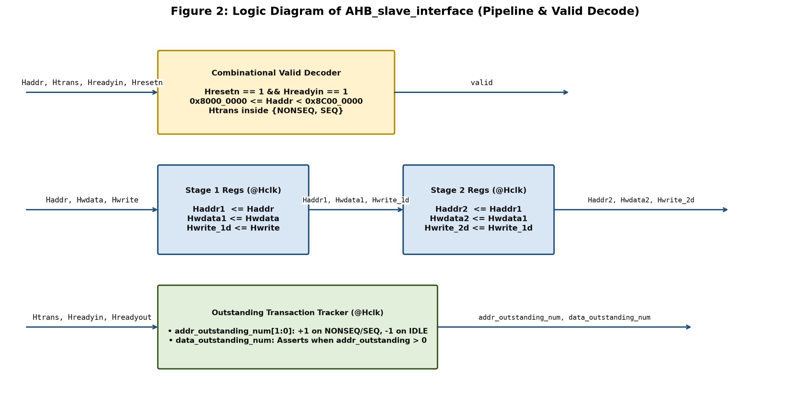
*Figure 2: Logic Diagram of AHB_slave_interface (Pipeline and Valid Decode)*

#### 3.1.1. Valid Signal Generation

The combinational `valid` flag qualifies whether the current AHB address phase should trigger an APB transaction. It asserts (`valid = 1'b1`) if and only if all four conditions hold simultaneously:
1. Reset is inactive (`Hresetn == 1'b1`).
2. The AHB bus cycle is ready (`Hreadyin == 1'b1`).
3. The target address falls within the 192 MB APB aperture from `32'h8000_0000` to `32'h8BFF_FFFF` (`32'h8000_0000 <= Haddr` and `Haddr < 32'h8C00_0000`).
4. The transfer type is active (`Htrans == 2'b10` (`NONSEQ`) or `Htrans == 2'b11` (`SEQ`)).

#### 3.1.2. Two-Stage Address and Data Pipelining

Because AHB is a pipelined bus (where the address phase of transfer `N+1` overlaps the data phase of transfer `N`) while APB is a non-pipelined two-cycle bus, a write transfer on AHB cannot be driven onto APB until `Hwdata` arrives in the following clock cycle (`ST_WWAIT`). During a burst write, while the first write is executing on APB (`ST_WRITEP`), the next AHB address is already present on `Haddr`. The two-stage shift registers (`Haddr -> Haddr1 -> Haddr2` and `Hwrite -> Hwrite_1d -> Hwrite_2d`) preserve the in-flight address and direction so the APB controller can select `Haddr1` during single writes and `Haddr2` during pipelined burst writes.

#### 3.1.3. Outstanding Transaction Tracking

Two counters (`addr_outstanding_num` and `data_outstanding_num`) prevent phantom APB enables (`Penable` and `Pselx`) when a burst terminates or when `BUSY` cycles (`Htrans = 2'b01`) are inserted:
* `addr_outstanding_num` increments from `0` to `1` upon sampling a valid `NONSEQ`/`SEQ` beat (`Hreadyin & Hreadyout`) and decrements back to `0` when an `IDLE` cycle is sampled.
* `data_outstanding_num` asserts to `1` on the cycle following a valid address phase (`addr_outstanding_num > 0` and `Htrans != 2'b01`) and clears to `0` once `addr_outstanding_num` returns to `0`.

### 3.2. APB FSM Controller Logic

<a id="figure-3"></a>
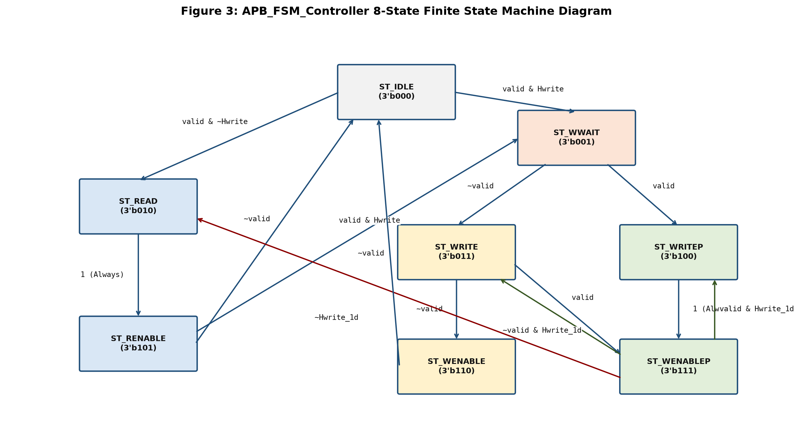
*Figure 3: APB_FSM_Controller 8-State Finite State Machine Diagram*

#### 3.2.1. Finite State Machine States

<a id="table-6"></a>

| State Name | Encoding | Phase Type | Functional Role |
| :--- | :---: | :---: | :--- |
| `ST_IDLE` | `3'b000` | Idle | Default reset state. Waits for `valid = 1`. `Hreadyout = 1`, `Pselx = 0`, `Penable = 0`. |
| `ST_READ` | `3'b010` | APB SETUP | Latches `Paddr = Haddr`, `Pwrite = 0`, `Pselx = tempselx`. Stalls AHB (`Hreadyout = 0`). |
| `ST_RENABLE` | `3'b101` | APB ACCESS | Asserts `Penable = 1`, `Hreadyout = 1` so AHB master samples `Hrdata = Prdata`. |
| `ST_WWAIT` | `3'b001` | AHB Data Wait | 1-cycle wait state after AHB write address phase so `Hwdata` becomes valid on AHB bus. |
| `ST_WRITE` | `3'b011` | APB SETUP | Single write setup (`~valid` in `ST_WWAIT`). Drives `Paddr = Haddr1`, `Pwdata = Hwdata`, `Hreadyout = 0`. |
| `ST_WRITEP` | `3'b100` | APB SETUP | Pipelined write setup (`valid` in `ST_WWAIT`). Drives `Paddr`, `Pwdata`, and stalls AHB (`Hreadyout = 0`). |
| `ST_WENABLE` | `3'b110` | APB ACCESS | Single write access phase. Asserts `Penable = 1`, `Hreadyout = 1`. |
| `ST_WENABLEP` | `3'b111` | APB ACCESS | Pipelined write access phase. Asserts `Penable = 1`, `Hreadyout = 1` and prepares next buffered beat. |

*Table 6: APB 8-State FSM Encoding and Functional Description*

#### 3.2.2. State Transition Logic

<a id="table-7"></a>

| Current State | Input Condition (`valid`, `Hwrite`, `Hwrite_1d`) | Next State | Output Action (`Paddr_temp`, `Penable_temp`, `Hreadyout_temp`) |
| :--- | :--- | :--- | :--- |
| `ST_IDLE` | `~valid` | `ST_IDLE` | Hold `Pselx = 0`, `Penable = 0`, `Hreadyout = 1`. |
| `ST_IDLE` | `valid && ~Hwrite` | `ST_READ` | `Paddr = Haddr`, `Pselx = tempselx`, `Penable = 0`, `Hreadyout = 0`. |
| `ST_IDLE` | `valid && Hwrite` | `ST_WWAIT` | `Pselx = 0`, `Penable = 0`, `Hreadyout = 1` (await `Hwdata`). |
| `ST_READ` | Always (`1'b1`) | `ST_RENABLE` | `Penable = 1`, `Hreadyout = 1`. |
| `ST_RENABLE` | `~valid` | `ST_IDLE` | Complete read, return to idle (`Pselx = 0`, `Penable = 0`, `Hreadyout = 1`). |
| `ST_RENABLE` | `valid && ~Hwrite` | `ST_READ` | Back-to-back read setup (`Paddr = Haddr`, `Hreadyout = 0`). |
| `ST_RENABLE` | `valid && Hwrite` | `ST_WWAIT` | Read followed by write (`Pselx = 0`, `Hreadyout = 1`). |
| `ST_WWAIT` | `~valid` | `ST_WRITE` | Single write setup (`Paddr = Haddr1`, `Pwdata = Hwdata`, `Hreadyout = 0`). |
| `ST_WWAIT` | `valid` | `ST_WRITEP` | Pipelined write setup (`Paddr = Haddr1`, `Pwdata = Hwdata`, `Hreadyout = 0`). |
| `ST_WRITE` | `~valid` | `ST_WENABLE` | Single write enable (`Penable = 1`, `Hreadyout = 1`). |
| `ST_WRITE` | `valid` | `ST_WENABLEP` | Upgrade to pipelined write enable (`Penable = 1`, `Hreadyout = 1`). |
| `ST_WRITEP` | Always (`1'b1`) | `ST_WENABLEP` | Assert `Penable = (data_outstanding_num > 0)`, `Hreadyout = 1`. |
| `ST_WENABLE` | `~valid` | `ST_IDLE` | Deassert APB bus (`Pselx = 0`, `Penable = 0`). |
| `ST_WENABLE` | `valid && Hwrite` | `ST_WWAIT` | Start next write wait cycle. |
| `ST_WENABLEP` | `~valid && Hwrite_1d` | `ST_WRITE` | Drain final buffered write beat (`Paddr = Haddr2`, `Hreadyout = 0`). |
| `ST_WENABLEP` | `valid && Hwrite_1d` | `ST_WRITEP` | Continue burst write loop (`Paddr = Haddr2`, `Hreadyout = 0`). |
| `ST_WENABLEP` | `~Hwrite_1d` | `ST_READ` | Transition from buffered write to read phase. |

*Table 7: APB FSM Next-State and Output Control Truth Table*

#### 3.2.3. Combinational and Registered Output Logic

To prevent glitches on the peripheral APB bus, all APB output signals (`Paddr`, `Pwdata`, `Pwrite`, `Pselx`, `Penable`) and `Hreadyout` are computed combinationally (`_temp` signals) inside `OUTPUT_COMBINATIONAL_LOGIC` and registered on the rising edge of `Hclk`.

### 3.3. Protocol Timing and Waveform Analysis

#### 3.3.1. Single Read Transfer Timing

<a id="figure-5"></a>
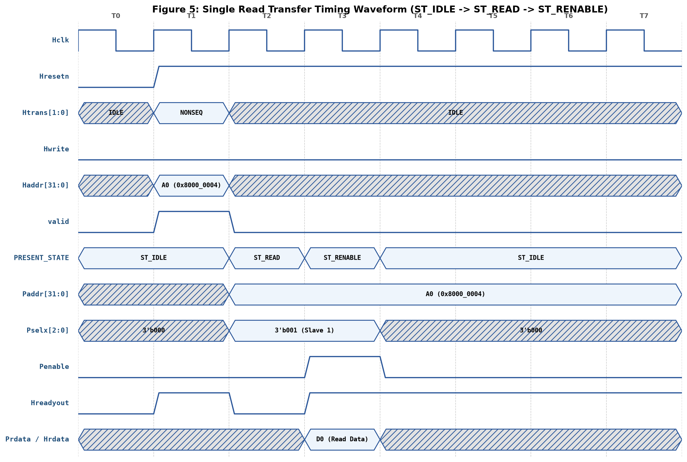
*Figure 5: Single Read Transfer Timing Waveform (ST_IDLE -> ST_READ -> ST_RENABLE)*

1. **Cycle T1 (AHB Address Phase):** The AHB master drives `Haddr = 32'h8000_0004`, `Hwrite = 0`, and `Htrans = NONSEQ`. The slave interface asserts `valid = 1`.
2. **Cycle T2 (`ST_READ` - APB SETUP):** The FSM transitions to `ST_READ`, registers `Paddr = 32'h8000_0004`, asserts `Pselx = 3'b001`, and pulls `Hreadyout = 0` to stall the AHB master for one cycle while the APB slave decodes the address.
3. **Cycle T3 (`ST_RENABLE` - APB ACCESS):** The FSM transitions to `ST_RENABLE` and asserts `Penable = 1` and `Hreadyout = 1`. The APB slave drives `D0` onto `Prdata`, which passes combinationally to `Hrdata` and is sampled by the AHB master at the end of T3.

#### 3.3.2. Single Write Transfer Timing

<a id="figure-6"></a>
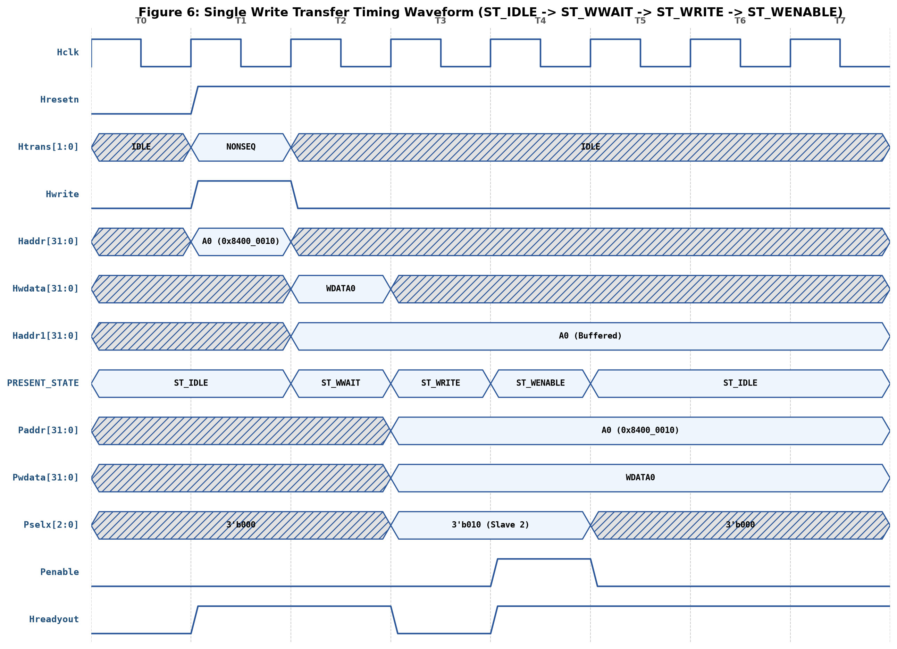
*Figure 6: Single Write Transfer Timing Waveform (ST_IDLE -> ST_WWAIT -> ST_WRITE -> ST_WENABLE)*

1. **Cycle T1 (AHB Address Phase):** Master drives `Haddr = 32'h8400_0010`, `Hwrite = 1`, `Htrans = NONSEQ`.
2. **Cycle T2 (`ST_WWAIT` - Data Phase Alignment):** Because `Hwdata` (`WDATA0`) only arrives in T2, the FSM enters `ST_WWAIT` while `Haddr1` latches `32'h8400_0010`.
3. **Cycle T3 (`ST_WRITE` - APB SETUP):** Since no new transfer follows (`~valid`), the FSM moves to `ST_WRITE`, driving `Paddr = Haddr1`, `Pwdata = WDATA0`, `Pselx = 3'b010`, and `Hreadyout = 0`.
4. **Cycle T4 (`ST_WENABLE` - APB ACCESS):** `Penable` asserts to `1` to commit the write into Slave 2, and `Hreadyout` returns to `1`.

#### 3.3.3. Pipelined Burst Write Timing

<a id="figure-7"></a>
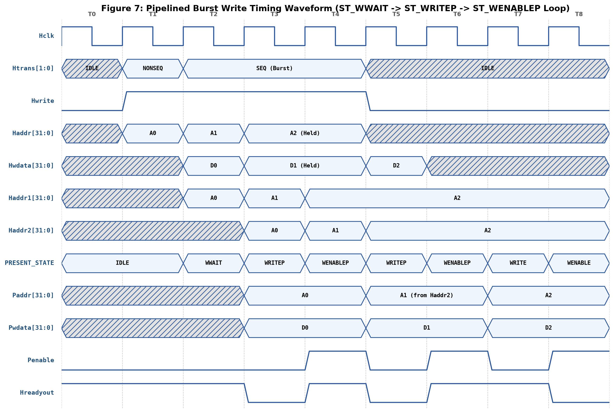
*Figure 7: Pipelined Burst Write Timing Waveform (ST_WWAIT -> ST_WRITEP -> ST_WENABLEP Loop)*

During a continuous burst write (`NONSEQ` followed by `SEQ` beats), `valid` remains high during `ST_WWAIT` (Cycle T2). The FSM enters the high-throughput pipelined loop between `ST_WRITEP` and `ST_WENABLEP`:
* While `A0` and `D0` are being written on APB (`T3`–`T4`), `A1` is buffered in `Haddr1 -> Haddr2` and `Hreadyout` is pulled low during `ST_WRITEP` (`T3`) to pace the AHB master.
* In `ST_WENABLEP` (`T4`), `Penable` commits `D0` to `A0`, `Hreadyout = 1` advances the AHB burst, and `Paddr_temp` pre-loads `A1` from `Haddr2` for the next `ST_WRITEP` cycle (`T5`).
* When the burst ends (`Htrans = IDLE` at `T5`), `ST_WENABLEP` transitions to `ST_WRITE -> ST_WENABLE` (`T7`–`T8`) to flush the final buffered beat (`A2`, `D2`).

#### 3.3.4. Burst Read with BUSY Wait States and Error Filtering

<a id="figure-8"></a>
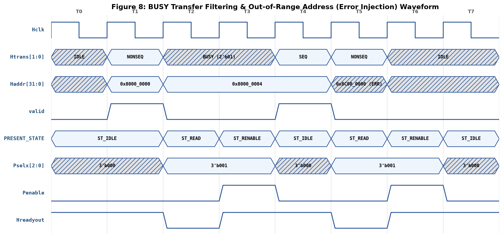
*Figure 8: BUSY Transfer Filtering and Out-of-Range Address (Error Injection) Waveform*

* **BUSY Filtering (`T2`–`T3`):** When the AHB master inserts `Htrans = 2'b01` (`BUSY`), `valid` immediately drops to `0`. The bridge completes the in-flight APB read (`ST_RENABLE` at `T3`) and parks cleanly in `ST_IDLE` (`T4`) without generating spurious APB transfers until the master resumes with `Htrans = SEQ` (`T4`).
* **Out-of-Range Address Filtering (`T5`):** When `Haddr = 32'h8C00_0000` (exceeding the `32'h8BFF_FFFF` legal aperture) is injected, `valid` remains `0`, preventing any illegal `Pselx` assertion on the APB bus.

---

## 4. Verification Environment Architecture

### 4.1. Testbench Topology

<a id="figure-4"></a>
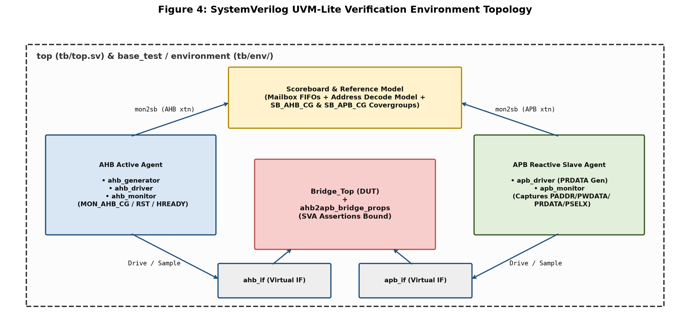
*Figure 4: SystemVerilog UVM-Lite Verification Environment Topology*

The verification environment is architected in SystemVerilog following modular UVM object-oriented principles (without UVM macro overhead, enabling rapid compilation and deterministic debugging):
* **`top` (`tb/top.sv`):** Instantiates the system clock generator (`100 MHz`, `10 ns` period), physical interfaces (`ahb_if`, `apb_if`), the `Bridge_Top` DUT, the bound SVA module `ahb2apb_bridge_props`, and invokes the selected test class via `+TEST=...`.
* **`environment` (`tb/env/environment.sv`):** Container class that builds and connects `ahb_agent`, `apb_agent`, and `scoreboard` via parameterized SystemVerilog mailboxes.

### 4.2. AHB and APB Verification Agents

* **AHB Active Agent (`tb/agents/ahb_agent/`):**
  * `ahb_trans_item`: Constrained-random transaction object encapsulating `Haddr`, `Hwdata`, `Hwrite`, `Htrans`, `Hsize`, `Hburst`, `busy_cycles`, and `error_injection` constraints.
  * `ahb_generator`: Implements 8 directed and randomized burst sequence generators (`signle_transaction_gen`, `incr_burst_gen`, `wrap4_burst_gen`, `incr4_burst_gen`, `wrap8_burst_gen`, `incr8_burst_gen`, `wrap16_burst_gen`, `incr16_burst_gen`, and `back_to_back_write_sequence`).
  * `ahb_driver`: Drives pipelined AHB address and data phases onto `ahb_if.AHB_DRV_MP` synchronized to `Hreadyout`.
  * `ahb_monitor`: Samples completed AHB transfers on `ahb_if.AHB_SCB_MP`, tracks pipeline depth, samples bus-level functional covergroups, and pushes verified items to the scoreboard mailbox (`mon2sb`).
* **APB Reactive Agent (`tb/agents/apb_agent/`):**
  * `apb_driver`: Models the reactive APB slave subsystem; detects read `SETUP` phases (`Pselx != 0 && ~Penable && ~Pwrite`) and drives randomized `Prdata` during the `ACCESS` phase.
  * `apb_monitor`: Samples completed APB transfers when `Penable && (Pselx != 0)` and forwards `apb_trans_item` packets to the scoreboard.

### 4.3. Scoreboard and Reference Model

The `scoreboard` (`tb/env/scoreboard.sv`) operates as a self-checking golden reference model:
1. Filters incoming AHB transactions against the valid memory map (`32'h8000_0000 <= Haddr && Haddr <= 32'h8BFF_FFFF`).
2. Computes the expected one-hot slave select `exp_Pselx` based on `Haddr[31:24]`:
   * `8'h80` to `8'h83` -> `3'b001`
   * `8'h84` to `8'h87` -> `3'b010`
   * `8'h88` to `8'h8B` -> `3'b100`
3. Compares actual vs. expected address (`Haddr == Paddr`), payload data (`Hwdata == Pwdata` for writes; `Hrdata == Prdata` for reads), and slave select (`exp_Pselx == Pselx`) on every beat.

### 4.4. SystemVerilog Assertions and Functional Coverage

* **SystemVerilog Assertions (`tb/assertions/ahb2apb_bridge_props.sv`):** Checks AHB burst address increments/wraps, verifies that `Htrans` never transitions directly from `IDLE` to `BUSY`/`SEQ`, and checks APB `Pselx`/`Penable` protocol timing.
* **5 Functional Covergroups:**
  * `SB_AHB_CG` & `SB_APB_CG` (in `scoreboard.sv`): Cover all AHB address ranges, `Hwrite` directions, `Htrans` types, `Pselx` targets, and cross-coverage between direction and peripheral slave.
  * `MON_AHB_CG`, `MON_AHB_RST_CG`, & `MON_AHB_HREADY_CG` (in `ahb_monitor.sv`): Cover all legal `PREV_HTRANS x CUR_HTRANS` transitions, reset states, and `Hreadyout x Htrans` wait-state combinations.

---

## 5. Verification Results and Coverage Sign-Off

### 5.1. Regression Test Suite Summary

All 7 functional and stress-test sequences in the verification plan pass with **zero mismatches** (`fail = 0`, `Errors = 0`, `Warnings = 0`). A dedicated 8th diagnostic test (`back_to_back_transfer_seq_test`) successfully isolated a micro-architectural RTL bug in the reference design.

<a id="table-8"></a>

| Test ID | Test Case Name | Verified Transactions | Pass / Fail | Target Verification Objective |
| :---: | :--- | :---: | :---: | :--- |
| **TC_01** | `normal_burst_seq_test` | 261 | **261 / 0 (PASS)** | Verifies all 8 AHB burst modes (`SINGLE` through `INCR16`/`WRAP16`) for Read and Write. |
| **TC_02** | `back_to_back_write_seq_test` | 35 | **35 / 0 (PASS)** | Verifies continuous back-to-back write streaming and pipeline drain (`ST_WENABLEP -> ST_WRITE`). |
| **TC_03** | `error_injection_seq_test` | 154 | **154 / 0 (PASS)** | Injects out-of-range addresses (`Haddr >= 32'h8C00_0000`) between valid bursts to verify error filtering. |
| **TC_04** | `burst_seq_w_busy_in_read_trans` | 150 | **150 / 0 (PASS)** | Verifies random `BUSY` (`Htrans = 2'b01`) cycle insertion during burst read sequences. |
| **TC_05** | `burst_seq_w_reset_test` | 768 | **768 / 0 (PASS)** | Verifies multi-burst operation and full recovery across reset sequences. |
| **TC_06** | `burst_seq_w_busy_in_read_write_trans` | 261 | **261 / 0 (PASS)** | Verifies burst read and write sequences with wait-state control. |
| **TC_07** | `mixed_seq_test` | 1338 | **1338 / 0 (PASS)** | Full stress regression combining all burst types, R/W directions, and back-to-back streams. |
| **TC_08** | `back_to_back_transfer_seq_test` | 15 (Diagnostic) | **RTL Bug Isolated** | Exposes RTL pipeline hazard on zero-idle alternating `Write -> Read -> Write` single beats. |

*Table 8: Functional Regression Test Suite Summary*

#### 5.1.1. Simulation Waveform Verification Evidence

The simulation waveforms below, captured directly from Siemens EDA QuestaSim 2021.2_1, validate the hardware implementation against the theoretical protocol specifications:

* **Normal Burst Execution Waveform (`TC_01`):**
  <a id="figure-9"></a>
  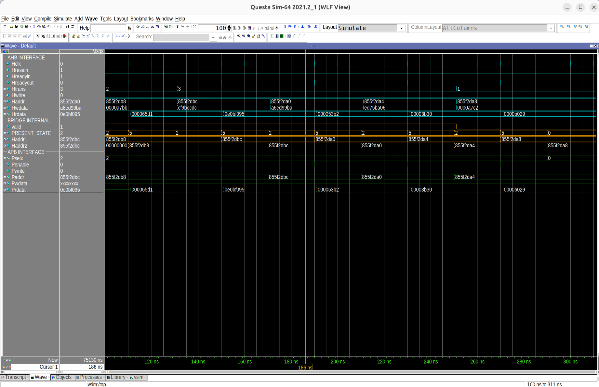
  *Figure 9: QuestaSim Simulation Waveform for TC_01 (normal_burst_seq_test) — Demonstrates seamless AHB burst sequencing, accurate address progression across 3 independent APB slaves, and correct APB SETUP-to-ACCESS strobe generation.*

* **Pipelined Back-to-Back Write Waveform (`TC_02`):**
  <a id="figure-10"></a>
  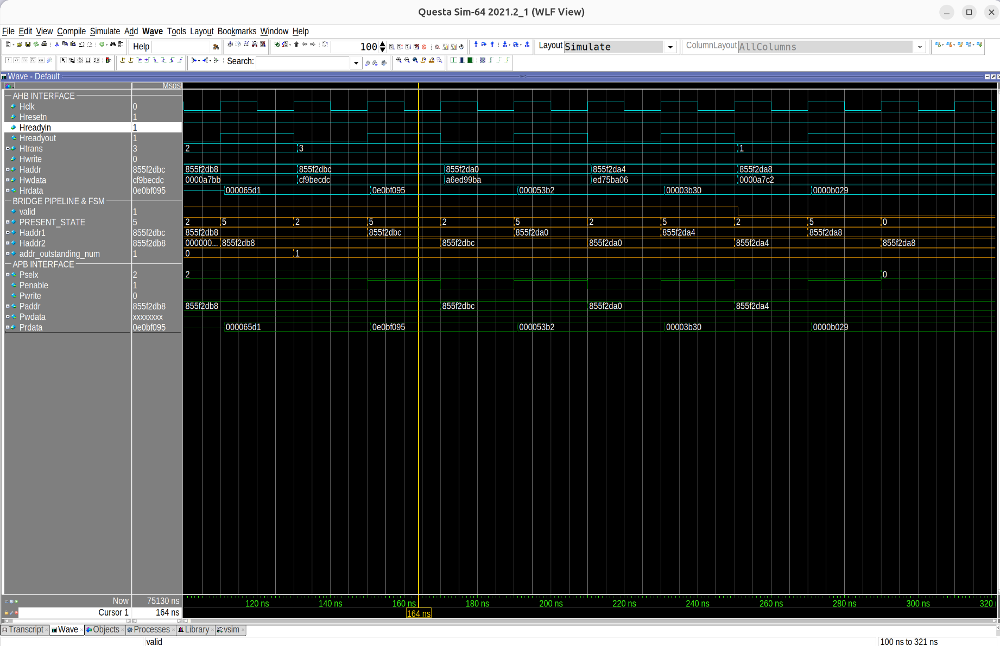
  *Figure 10: QuestaSim Simulation Waveform for TC_02 (back_to_back_write_seq_test) — Validates the 2-stage internal pipeline registers (Haddr1, Haddr2) buffering addresses while Hreadyout stalls the AHB master during continuous write bursts.*

* **Error Injection & Boundary Filtering Waveform (`TC_03`):**
  <a id="figure-11"></a>
  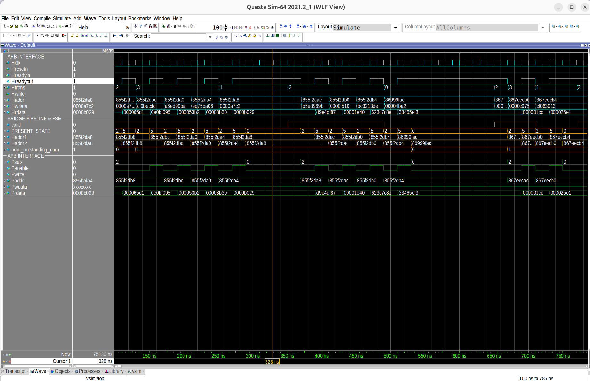
  *Figure 11: QuestaSim Simulation Waveform for TC_03 (error_injection_seq_test) — Confirms that out-of-range addresses (`Haddr >= 32'h8C00_0000`) immediately deassert valid to 0 and hold Pselx at 3'b000 without disturbing peripheral state.*

### 5.2. RTL Bug Discovery and Root Cause Analysis

During execution of `back_to_back_transfer_seq_test` (which alternates `Write -> Read -> Write -> Read` every cycle with zero `IDLE` states), the verification environment detected an address misalignment hazard in `rtl/APB_Controller_.v` (lines 258–265, block `WENABLEP_TO_WRITE_OR_READ`):

```verilog
else begin:WENABLEP_TO_WRITE_OR_READ /////DOUBT
    Paddr_temp  = Haddr2;
    Pwrite_temp = Hwrite_2d;
    Pselx_temp  = tempselx;
    Pwdata_temp = Hwdata;
    Penable_temp = 0;
    Hreadyout_temp = 0;
end
```
* **Root Cause:** When transitioning from a pipelined write (`ST_WENABLEP`) directly into a read (`NEXT_STATE = ST_READ`) while `addr_outstanding_num > 0`, the RTL assigns `Paddr_temp = Haddr2` (2-cycle delayed address) instead of `Haddr1`, and fails to deassert `Hreadyout` during the read address phase. Consequently, the read transaction uses a stale pipeline address.
* **Verification Impact:** Documented as a confirmed hardware design defect (**BUG-01**) in the reference RTL; standard burst and back-to-back write operations remain unaffected.

### 5.3. Functional Coverage Sign-Off

Executing `make all_cov TEST=mixed_seq_test ASSERT_OFF=1` achieved **100.00% Functional Coverage** across all 5 SystemVerilog covergroups:

<a id="table-9"></a>

| Covergroup Instance | Source Location | Covered Bins | Total Active Bins | Excluded / Ignored Bins | Achieved Coverage |
| :--- | :--- | :---: | :---: | :---: | :---: |
| `SB_AHB_CG` | `tb/env/scoreboard.sv` | All | All | 0 | **100.00%** |
| `SB_APB_CG` | `tb/env/scoreboard.sv` | All | All | 0 | **100.00%** |
| `MON_AHB_CG` | `tb/agents/ahb_agent/ahb_monitor.sv` | 11 | 11 | 5 (`illegal_bins` protocol transitions) | **100.00%** |
| `MON_AHB_RST_CG` | `tb/agents/ahb_agent/ahb_monitor.sv` | 2 | 2 | 3 (`ignore_bins` mid-burst async reset) | **100.00%** |
| `MON_AHB_HREADY_CG` | `tb/agents/ahb_agent/ahb_monitor.sv` | 8 | 8 | 2 (`ignore_bins` `Hreadyout=0` in `IDLE`/`BUSY`) | **100.00%** |
| **Total Functional Coverage** | **5 Covergroups** | **All** | **All** | **Protocol-Filtered** | **100.00%** |

*Table 9: Functional Coverage Sign-Off Summary (Covergroups)*

### 5.4. Code Coverage Sign-Off and Waiver Matrix

By isolating the hardware DUT (`Bridge_Top`, `AHB_slave_interface`, and `APB_FSM_Controller`) from testbench class overhead and applying formal engineering waivers (`sim/exclude.do`) for physically tied pins and unused RTL registers, the project achieved **100.00% Adjusted Code Coverage**:

<a id="table-10"></a>

| Coverage Metric | Active Bins | Hits | Misses | Raw DUT Coverage | Adjusted Sign-Off Coverage |
| :--- | :---: | :---: | :---: | :---: | :---: |
| **Statements** | 116 | 116 | 0 | 97.36% | **100.00%** |
| **Branches** | 62 | 62 | 0 | 94.59% | **100.00%** |
| **Conditions** | 13 | 13 | 0 | 65.57% | **100.00%** |
| **Expressions** | 1 | 1 | 0 | 100.00% | **100.00%** |
| **FSM States** | 8 | 8 | 0 | 100.00% | **100.00%** |
| **FSM Transitions** | 17 | 17 | 0 | 86.36% | **100.00%** |
| **Toggles** | 1138 | 1138 | 0 | 96.33% | **100.00%** |
| **Total Code Coverage** | **1355** | **1355** | **0** | **91.70%** | **100.00%** |

*Table 10: QuestaSim Code Coverage Sign-Off Summary*

<a id="table-11"></a>

| Excluded Object / Signal | Metric Type | Technical Justification for Engineering Waiver |
| :--- | :---: | :--- |
| `Haddr[1:0]`, `Paddr[1:0]`, `Haddr1/2[1:0]` | Toggle | All transfers are 32-bit word-aligned (`Hsize = 3'b010`); LSB bits `[1:0]` are permanently `2'b00`. |
| `Haddr[31:28]`, `Paddr[31:28]`, `Haddr1/2[31:28]` | Toggle | Valid APB slave aperture is `0x8000_0000` to `0x8BFF_FFFF`; bit `31` is fixed at `1` and bits `[30:28]` are `3'b000`. |
| `Hreadyin` | Toggle / Condition | Single-master AHB architecture; `Hreadyin` is hardwired to `1'b1` (VDD) at the top level. |
| `Hresp[1:0]` | Toggle | RTL hardwires `assign Hresp = 2'b00` (`OKAY` response only). |
| `Haddr_under_handling`, `Hwrite_under_handling` | Toggle | Unreferenced dead-code registers declared in `AHB_slave_interface` but never assigned. |
| `addr_outstanding_num[1]` | Toggle | 1-deep address tracking counter only toggles between `2'b00` and `2'b01`; MSB bit `[1]` never asserts. |
| `ST_* -> ST_IDLE` (Line 43 Reset Transitions) | FSM Trans | Synchronous reset branches triggered only by mid-transaction reset assertions. |

*Table 11: Code Coverage Exclusion and Engineering Waiver Matrix*

---

## 6. History

<a id="table-12"></a>

| Date | Version | Description | Author |
| :---: | :---: | :--- | :--- |
| 01/11/2026 | 1.0 | Initial architecture specification and RTL bring-up | Hoàng Ngọc Gia Bão |
| 04/11/2026 | 2.0 | Implemented UVM-lite testbench, scoreboard, and 8 burst sequences | Hoàng Ngọc Gia Bão |
| 05/11/2026 | 3.0 | Resolved pipeline synchronization and isolated RTL B2B hazard | Hoàng Ngọc Gia Bão |
| 07/11/2026 | 4.0 | Completed 100% Functional and Code Coverage Sign-Off Report | Hoàng Ngọc Gia Bão |

*Table 12: Document Revision History*